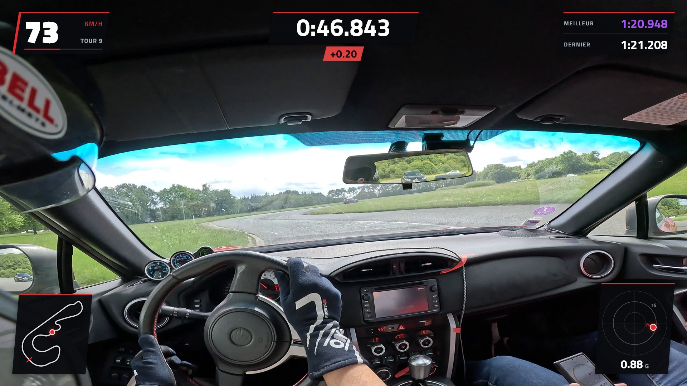
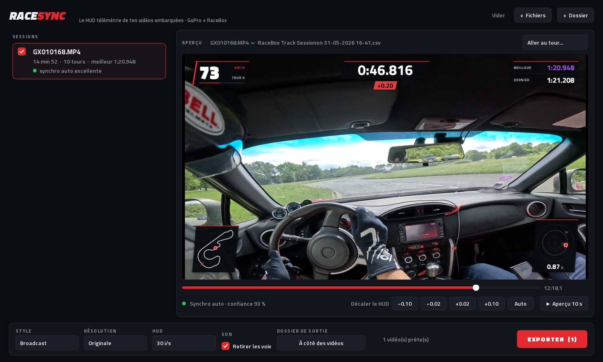

# RaceSync

**Le HUD télémétrie style F1 pour tes vidéos embarquées.**
Tu donnes tes vidéos GoPro et tes sessions RaceBox, RaceSync s'occupe du reste :
il retrouve quelle vidéo va avec quelle session, les synchronise au centième près
et incruste un HUD propre — vitesse, chrono, delta, meilleur tour, tracé du circuit, G.

Gratuit et libre (GPL-3.0), sans filigrane, sans compte, tout tourne sur ton PC.





---

## Ce que fait RaceSync

- **Synchro automatique au centième.** L'heure GPS de la GoPro ne suffit pas (elle peut
  être fausse d'une seconde, ou absente). RaceSync compare l'accéléromètre de la GoPro
  à celui du RaceBox : freinages et virages laissent la même signature dans les deux
  capteurs, et le décalage qui les superpose est le bon. Ça marche même si la caméra
  est sur le casque, et même si elle n'a jamais capté le GPS.
- **Association automatique.** Glisse un dossier entier : chaque vidéo est rattachée à la
  bonne session RaceBox.
- **Chronos exacts.** Les temps au tour sont calculés à l'instant précis du passage de la
  ligne, pas arrondis à l'image près.
- **Meilleur tour et delta « en direct ».** Le HUD n'affiche que ce qui s'est déjà passé :
  pas de spoiler du meilleur tour dès le début de la vidéo. Le delta compare ta position
  sur la trajectoire de ton meilleur tour, pas juste la distance parcourue.
- **HUD net en 4K**, fluide en 30 ou 60 images/s, trois styles : Broadcast (F1), Carbone, Épuré.
- **Aperçu avant export**, avec réglage fin de la synchro si tu veux chipoter.
- **Suppression des voix (option)** : garde le son du moteur et de la route.
- **Robuste** : un export interrompu ne laisse jamais de fichier à moitié écrit, le PC ne se
  met pas en veille pendant l'export, et la priorité est basse pour que tu puisses jouer
  ou naviguer en même temps.

## Matériel compatible

- **Caméras** : GoPro HERO5 et plus récentes (télémétrie GPMF).
- **Données** : RaceBox Mini / Mini S / Micro, export **CSV**.
- **Encodage** : carte NVIDIA, AMD ou Intel (accélération matérielle), sinon le processeur.

### Exporter ta session depuis l'app RaceBox

Format **CSV**, préréglage **Custom**, **Full Date/Time** en **UTC**.
(L'heure locale marche aussi : RaceSync corrige le fuseau.)

## Utilisation

1. Lance RaceSync.
2. Glisse tes vidéos GoPro et tes CSV RaceBox (ou un dossier) dans la fenêtre.
3. Vérifie l'aperçu — la pastille verte indique une synchro sûre.
4. Choisis le style, la résolution, puis **Exporter**.

Les vidéos sont créées à côté des originales (`GX010166_RaceSync.mp4`) ou dans le
dossier de ton choix. Les vidéos déjà exportées sont reconnues et sautées.

## Installation

### Depuis les sources

Il faut [Python 3.10+](https://www.python.org/) et [ffmpeg](https://ffmpeg.org/download.html)
(dans le PATH, ou `ffmpeg.exe` dans un dossier `ffmpeg` à côté de RaceSync).

```bash
git clone https://github.com/shdroudlepoup/RaceSync.git
cd RaceSync
python -m venv .venv
.venv\Scripts\pip install -r requirements.txt
.venv\Scripts\python -m racesync
```

Sous Windows, `RaceSync.bat` fait tout ça pour toi.

Suppression des voix (facultatif, ~3 Go avec PyTorch, carte NVIDIA conseillée) :

```bash
.venv\Scripts\pip install "audio-separator[gpu]"
```

## Comment ça marche (pour les curieux)

| Module | Rôle |
|---|---|
| `racesync/gopro.py` | Lit la télémétrie GoPro directement dans le MP4 (accéléromètre 200 Hz, GPS, heure GPS) en quelques millisecondes |
| `racesync/racebox.py` | Lit l'export CSV RaceBox |
| `racesync/sync.py` | Synchro par corrélation croisée des accéléromètres (FFT), toutes orientations de caméra |
| `racesync/session.py` | Tours, chronos au passage de ligne, delta, recalage des G (sens, biais, vibrations) |
| `racesync/hud/` | Rendu du HUD avec Skia, indépendant de la résolution |
| `racesync/export.py` | Rendu parallèle + incrustation et encodage par ffmpeg |
| `racesync/app/` | Interface (Qt) |

Convention des G : le point montre la **force ressentie** — virage à droite → point à gauche,
freinage → point en haut, accélération → point en bas.

## Contribuer

Les retours, idées et corrections sont les bienvenus : ouvre une *issue* ou une *pull request*.
Envie d'ajouter un autre boîtier (AiM, VBOX, RaceChrono…) ? Il suffit d'écrire un lecteur
qui produit les mêmes données que `racebox.py`.

## Licence

RaceSync est un logiciel libre sous licence **GNU GPL v3.0 ou ultérieure** — voir [LICENSE](LICENSE).
Tu peux l'utiliser, le modifier et le partager librement ; toute version redistribuée doit
rester libre et fournie avec son code source.

Polices incluses : Titillium Web, Barlow Semi Condensed, Chakra Petch — SIL Open Font License
(voir `racesync/assets/fonts`). RaceSync utilise [Skia](https://skia.org/),
[Qt / PySide6](https://www.qt.io/), [FFmpeg](https://ffmpeg.org/) et, en option,
[audio-separator](https://github.com/nomadkaraoke/python-audio-separator) (modèle BS-Roformer).

RaceSync n'est affilié ni à GoPro, ni à RaceBox.

---

## English

**RaceSync** burns a clean, F1-style telemetry HUD (speed, lap timer, live delta, best/last lap,
track map, G-meter) onto GoPro onboard videos using RaceBox CSV data. It pairs each video with
its session and syncs them to a few hundredths of a second by cross-correlating the GoPro's
accelerometer with the RaceBox's — no manual offset, even without GPS time in the video.
Free software under GPL-3.0-or-later. Run from source with `python -m racesync`.
